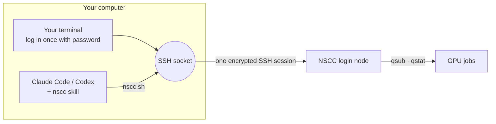

<div align="center">

# nscc-agent

**Let Claude Code or Codex run and babysit your experiments on Singapore's NSCC supercomputer.**

[](#install)
[](#install)
[](#platforms)
[](LICENSE)

English · [简体中文](README.zh-CN.md)

</div>

## Why

You can't run Claude Code or Codex on NSCC, and NSCC only accepts passwords, so an agent on your laptop can't log in either. Experiments end up watched by nobody: a job crashes ten minutes in and you find out the next morning.

**nscc-agent** fixes that. You log in **once** in your own terminal; the agent on your computer reuses that SSH connection to upload code, set up environments, submit PBS jobs, **watch them until they finish, read the logs, fix failures and resubmit**. Your password never leaves your terminal.

An example session:

```text
You    ▸ Fine-tune configs/lora.yaml on 1 GPU on NSCC and watch it.
Agent  ▸ Uploaded code (412 MB, .venv excluded) → submitted 25936201 to g1, started in 3 min.
       ▸ 40 min: loss 1.92 → 1.31, 18 GB GPU memory, ETA 2 h 10 min.
       ▸ Job failed: CUDA out of memory at eval. Halved eval batch size, resumed from step 1200 → 25936288.
       ▸ Done. Exit 0, best val loss 1.07. Results copied to runs/lora-0423/.
```

## Install

<details open>
<summary><b>Claude Code</b> (plugin)</summary>

```text
/plugin marketplace add LBWSquare666/nscc-agent
/plugin install nscc-agent@nscc-agent
```
</details>

<details>
<summary><b>Codex</b>, or Claude Code without plugins</summary>

```bash
curl -fsSL https://raw.githubusercontent.com/LBWSquare666/nscc-agent/main/install.sh | bash
```

Copies the skill to `~/.claude/skills/nscc` and `~/.agents/skills/nscc`. Use `bash -s claude` or `bash -s codex` for just one.
</details>

## Quick start

1. **Tell it who you are** (not secrets; once per computer):

   ```bash
   mkdir -p ~/.config/nscc && cat > ~/.config/nscc/config <<'EOF'
   NSCC_USER=<your NSCC username>
   NSCC_HOST=aspire2antu.nscc.sg
   NSCC_PROJECT=<your PBS project id>
   EOF
   ```

2. **Ask your agent to connect.** "Connect to NSCC" (or `/nscc-agent:nscc` in Claude Code, `$nscc` in Codex). It replies with one `ssh` command. **Run it in your own terminal** and type your password. The connection stays open until you close it or your computer goes offline.

3. **Hand over the experiment.**

   - "Upload `./data` to my scratch and set up a uv environment for this repo."
   - "Run `train.py` on 1 GPU for 4 hours and tell me when it finishes."
   - "My job 25936169 failed. Find out why and fix it."
   - "What's running on NSCC? Show me the last lines of each log."

## How it works



The skill teaches the agent the NSCC workflow and rules; a small script, [`nscc.sh`](plugins/nscc-agent/skills/nscc/scripts/nscc.sh), does the work:

| | |
|---|---|
| `check` · `login` | Is the connection up? If not, print the login command for you |
| `run` | Run a command or a heredoc script on the login node |
| `put` · `get` | Resumable rsync both ways |
| `submit` | Upload a PBS script and `qsub` it with your project id |
| `jobs` · `status` · `tail` | Recent jobs, one job's state and exit code, a log's last lines |
| `wait` | Block (in the background) until a job ends; exit code tells success, failure or lost connection |

If your laptop sleeps, jobs keep running on NSCC. Log in again and the agent picks up from the job history.

## Security

- The agent never sees, types or stores your password. No `sshpass`, `expect` or password files.
- Only the socket you opened is used; it lives in `~/.ssh/cm/` and is readable only by you. Ask the agent to close it any time (`nscc.sh close`).
- API keys that a job needs are written on NSCC by a command **you** run (`read -s`, no echo), never pasted into the chat.
- Anyone who can run commands as you on your computer can use the open socket, just as with any SSH session.

## Platforms

| | |
|---|---|
| macOS, Linux | ✅ |
| Windows | ✅ in **WSL2** (run the agent inside WSL). Native Windows OpenSSH has no connection sharing |
| NSCC systems | Tested on **ASPIRE 2A** (NTU login, Oct 2026). Other login hosts: set `NSCC_HOST` |

## NSCC rules worth knowing

- Submit to `-q normal`; PBS routes by GPU count (1 → g1, 2–3 → g2, 4 → g3).
- GPU walltime must be **more than 2 hours** (use `02:10:00` for short jobs) and at most 24 h.
- **One running job per queue per user**, across all your projects.
- 1-GPU jobs often start within minutes; 2–3-GPU jobs can wait hours.
- Work in `/scratch` (large, purged periodically), not home (~50 GB).
- Driver 570 / CUDA 12.8: cu13x wheels (e.g. recent vLLM) need an Apptainer container with `/usr/local/cuda/compat`.

More: [PBS](plugins/nscc-agent/skills/nscc/references/pbs.md) · [environment](plugins/nscc-agent/skills/nscc/references/environment.md) · [troubleshooting](plugins/nscc-agent/skills/nscc/references/troubleshooting.md)

## FAQ

**Can I use an SSH key instead?** Not on ASPIRE 2A login nodes today; they accept passwords only. That's why the socket is needed.

**Does the agent keep watching if I close the chat?** No. The agent runs on your computer, so keep the session (and the computer) on for long runs. Jobs themselves don't depend on it.

**It keeps asking me to log in.** Your computer slept or changed network, which closes the connection. Run the login command again.

**VS Code Remote-SSH?** Works side by side; it opens its own connection and asks for your password itself.

---

<sub>Unofficial. Not affiliated with or endorsed by NSCC Singapore. MIT © LBWSquare</sub>
