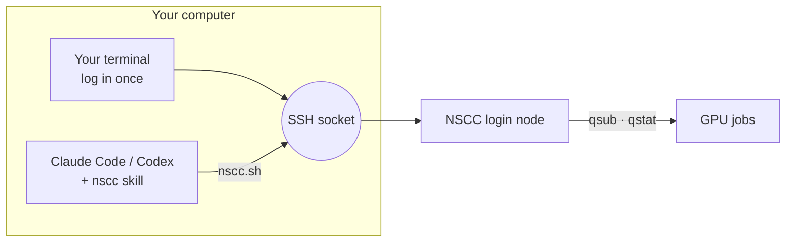

<div align="center">

# nscc-agent

**Let Claude Code or Codex run and babysit your experiments on Singapore's NSCC supercomputer.**

[](#install)
[](#install)
[](#install)
[](LICENSE)

Author: LBWSquare

English · [简体中文](README.zh-CN.md)

</div>

## What it does

Log in once in your own terminal, and the agent can:

- Upload code and set up environments
- Submit PBS jobs
- Watch them until they finish and read the logs
- Find out why a job failed, fix it and resubmit

Your password stays in your own terminal; the agent never sees it.

## Why

- **Passwords only.** NSCC login nodes don't accept SSH keys, so an agent can't log in by itself.
- **The official Claude Code install fails on NSCC.** NSCC blocks `claude.ai` and npm, so the official install command stops with `SSL_ERROR_SYSCALL`.

## Two ways to run it

| | **A. Agent on your computer** (default) | **B. Agent on NSCC** |
|---|---|---|
| How | The agent reuses an SSH connection you opened | Claude Code on the login node, kept alive in `tmux`, steered from your phone with Remote Control |
| Pros | Claude Code and Codex; code stays local; nothing installed on NSCC | Computer can be off; check in from your phone; no drop when your laptop sleeps |
| Cons | Computer must stay on and online, and you re-type the password after it sleeps; Windows needs WSL2 | Claude Code only, needs a Pro/Max/Team/Enterprise plan; restart it by hand after a login-node reboot |
| Setup | [Quick start](#quick-start) | [`on-nscc.md`](plugins/nscc-agent/skills/nscc/references/on-nscc.md) |

Use A at your desk and B for overnight runs; they work side by side.

## Install

<details open>
<summary><b>Claude Code</b> (plugin)</summary>

```text
/plugin marketplace add LBWSquare666/nscc-agent
/plugin install nscc-agent@nscc-agent
```
</details>

<details>
<summary><b>Codex</b>, or Claude Code without plugins</summary>

```bash
curl -fsSL https://raw.githubusercontent.com/LBWSquare666/nscc-agent/main/install.sh | bash
```
</details>

Works on macOS, Linux and Windows (WSL2).

## Quick start

1. **Tell it who you are** (not secrets; once per computer):

   ```bash
   mkdir -p ~/.config/nscc && cat > ~/.config/nscc/config <<'EOF'
   NSCC_USER=<your NSCC username>
   NSCC_HOST=aspire2antu.nscc.sg
   NSCC_PROJECT=<your PBS project id>
   EOF
   ```

2. **Ask your agent to connect.** Say "Connect to NSCC". It replies with one `ssh` command; run it in your own terminal and type your password.

3. **Hand over the experiment.** For example:
   - "Run `train.py` on 1 GPU for 4 hours and tell me when it finishes."
   - "My job 25936169 failed. Find out why and fix it."

## How it works



The skill teaches the agent the NSCC workflow and rules; [`nscc.sh`](plugins/nscc-agent/skills/nscc/scripts/nscc.sh) does the work:

| Command | Does |
|---|---|
| `check` | Is the connection up? If not, print the login command |
| `run` | Run a command on the login node |
| `put` · `get` | Upload and download (resumable) |
| `submit` | Submit a PBS job |
| `jobs` · `status` · `tail` | List jobs, show a job's state, read a log |
| `wait` | Wait in the background until a job ends |

NSCC rules and troubleshooting: [PBS](plugins/nscc-agent/skills/nscc/references/pbs.md) · [environment](plugins/nscc-agent/skills/nscc/references/environment.md) · [troubleshooting](plugins/nscc-agent/skills/nscc/references/troubleshooting.md)

## Security

- The agent never sees, types or stores your password.
- Only the connection you opened is used; close it any time (`nscc.sh close`).
- API keys a job needs are written on NSCC by you in your own terminal, never through the chat.

## FAQ

**Does it keep watching if I close the chat?** In way A, no: keep the computer and the session on. In way B, yes. Jobs keep running either way.

**It keeps asking me to log in.** Your computer slept or changed network, which closes the connection. Run the login command again. To keep watching with your computer off, use way B.

---

<sub>Unofficial. Not affiliated with or endorsed by NSCC Singapore. MIT © LBWSquare</sub>
