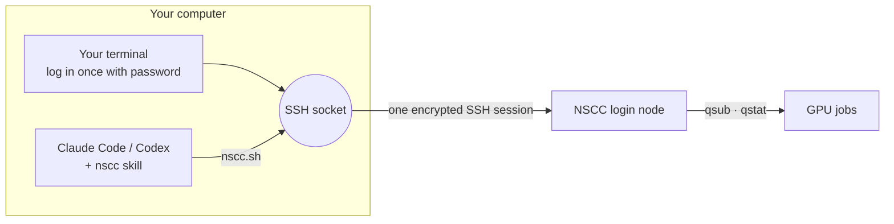
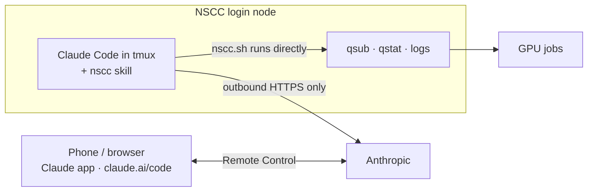

<div align="center">

# nscc-agent

**Let Claude Code or Codex run and babysit your experiments on Singapore's NSCC supercomputer.**

[](#install)
[](#install)
[](#platforms)
[](LICENSE)

English · [简体中文](README.zh-CN.md)

</div>

## Why

Getting a coding agent to work on NSCC runs into two problems:

- **Passwords only (on most hosts).** The NTU login host `aspire2antu.nscc.sg` doesn't accept SSH keys, so an agent on your laptop can't log in by itself. (The NUS host `aspire2a.nus.edu.sg` reportedly accepts keys from the NSCC portal; `nscc.sh` then logs in by itself, see [FAQ](#faq).)
- **The official Claude Code install fails on NSCC.** Following the [Claude Code docs](https://code.claude.com/docs/en/overview), `curl -fsSL https://claude.ai/install.sh | bash` stops with `SSL_ERROR_SYSCALL` because NSCC blocks `claude.ai`, and `npm install` fails because `registry.npmjs.org` is blocked too. The fix is in [`on-nscc.md`](plugins/nscc-agent/skills/nscc/references/on-nscc.md#1-install).

So experiments end up watched by nobody: a job crashes ten minutes in and you find out the next morning.

**nscc-agent** fixes that. You log in **once** in your own terminal; the agent reuses that login to upload code, set up environments, submit PBS jobs, **watch them until they finish, read the logs, fix failures and resubmit**. Your password never leaves your terminal.

## Two ways to run it

| | **A. Agent on your computer** (default) | **B. Agent on NSCC** |
|---|---|---|
| How | Agent on your laptop drives NSCC through an SSH socket you opened | Claude Code installed on the login node, kept alive in `tmux`, steered from your phone or browser with [Remote Control](https://code.claude.com/docs/en/remote-control) |
| Your computer | Must stay on and online for the whole run | Only to start it; can be off afterwards |
| Agents | Claude Code, Codex | Claude Code only |
| Setup | [Quick start](#quick-start) | [`on-nscc.md`](plugins/nscc-agent/skills/nscc/references/on-nscc.md) |

**A. Agent on your computer**

- ✅ Works with Claude Code and Codex, in any client (terminal, desktop app, IDE).
- ✅ Code and results stay in your local repo; `put`/`get` sync them.
- ✅ Nothing installed on NSCC, nothing running on the shared login node, your Claude login stays on your machine.
- ✅ Any account type, API keys included.
- ❌ The computer must stay awake and online. Sleep or a network change drops the socket, and on password-only hosts you have to type your password again, so overnight runs need a machine left on (e.g. in the lab). With an SSH key it reconnects by itself.
- ❌ Windows needs WSL2.
- ❌ Every command is an SSH round trip, and code has to be uploaded.

**B. Agent on NSCC**

- ✅ Your computer can be off: watch and steer from the Claude app or claude.ai/code, from anywhere.
- ✅ No socket to drop when your laptop sleeps or changes network; no uploads, the agent sees jobs, logs and files directly.
- ✅ Starting it only needs a terminal on NSCC (VS Code Remote-SSH is enough), so no WSL on Windows.
- ❌ Claude Code only, installed from `downloads.claude.ai` because `claude.ai` and npm are blocked on NSCC.
- ❌ Remote Control needs a claude.ai Pro, Max, Team or Enterprise login (no API key); on Team/Enterprise an Owner must enable it. **Not yet verified on NSCC.**
- ❌ Lives in `tmux` on one of two login nodes. A login-node reboot, maintenance, or NSCC killing long-running processes stops it, and someone has to log in with the password to restart it.
- ❌ Runs on a shared login node: light work only, and your Claude login token is stored in `~/.claude` there.
- ❌ Your code lives on NSCC; edit it there or `git pull` it on the login node.

Use A at your desk and B for overnight and weekend runs; they don't conflict.

## Install

<details open>
<summary><b>Claude Code</b> (plugin)</summary>

```text
/plugin marketplace add LBWSquare666/nscc-agent
/plugin install nscc-agent@nscc-agent
```
</details>

<details>
<summary><b>Codex</b>, or Claude Code without plugins</summary>

```bash
curl -fsSL https://raw.githubusercontent.com/LBWSquare666/nscc-agent/main/install.sh | bash
```

Copies the skill to `~/.claude/skills/nscc` and `~/.agents/skills/nscc`. Use `bash -s claude` or `bash -s codex` for just one.
</details>

## Quick start

This is way A. For way B, follow [`on-nscc.md`](plugins/nscc-agent/skills/nscc/references/on-nscc.md): install Claude Code and this skill on NSCC, start `claude --remote-control` inside `tmux`, then open the session from your phone.

1. **Tell it who you are** (not secrets; once per computer):

   ```bash
   mkdir -p ~/.config/nscc && cat > ~/.config/nscc/config <<'EOF'
   NSCC_USER=<your NSCC username>
   NSCC_HOST=aspire2antu.nscc.sg
   NSCC_PROJECT=<your PBS project id>
   EOF
   ```

   NUS host with an SSH key: use `NSCC_HOST=aspire2a.nus.edu.sg` and add `NSCC_KEY=~/.ssh/<your key>` (or set the key in `~/.ssh/config`).

2. **Ask your agent to connect.** "Connect to NSCC" (or `/nscc-agent:nscc` in Claude Code, `$nscc` in Codex). With a working SSH key it connects by itself. Otherwise it replies with one `ssh` command: **run it in your own terminal** and type your password. The connection stays open until you close it or your computer goes offline.

3. **Hand over the experiment.**

   - "Upload `./data` to my scratch and set up a uv environment for this repo."
   - "Run `train.py` on 1 GPU for 4 hours and tell me when it finishes."
   - "My job 25936169 failed. Find out why and fix it."
   - "What's running on NSCC? Show me the last lines of each log."

## How it works



The skill teaches the agent the NSCC workflow and rules; a small script, [`nscc.sh`](plugins/nscc-agent/skills/nscc/scripts/nscc.sh), does the work:

| | |
|---|---|
| `check` · `login` | Is the connection up? If not, print the login command for you |
| `run` | Run a command or a heredoc script on the login node |
| `put` · `get` | Resumable rsync both ways |
| `submit` | Upload a PBS script and `qsub` it with your project id |
| `jobs` · `status` · `tail` | Recent jobs, one job's state and exit code, a log's last lines |
| `wait` | Block (in the background) until a job ends; exit code tells success, failure or lost connection |

If your laptop sleeps, jobs keep running on NSCC. Log in again and the agent picks up from the job history.

In way B the agent and `nscc.sh` run on the login node, and only the chat travels through Anthropic:



`nscc.sh` notices it is on an `asp2a-login*` host and runs commands directly, so the same skill works in both ways.

## Security

- The agent never sees, types or stores your password. No `sshpass`, `expect` or password files.
- Only your own login is used: the socket you opened, or your SSH key if the host accepts one. The socket lives in `~/.ssh/cm/` and is readable only by you. Ask the agent to close it any time (`nscc.sh close`).
- API keys that a job needs are written on NSCC by a command **you** run (`read -s`, no echo), never pasted into the chat.
- Anyone who can run commands as you on your computer can use the open socket, just as with any SSH session.

## Platforms

| | |
|---|---|
| macOS, Linux | ✅ |
| Windows | ✅ in **WSL2** (run the agent inside WSL). Native Windows OpenSSH has no connection sharing |
| NSCC systems | Tested on **ASPIRE 2A** (NTU login, Oct 2026). Other login hosts: set `NSCC_HOST` |
| Way B | Claude Code 2.1.309 installed and running on `asp2a-login-ntu01` (Oct 2026). Remote Control from NSCC not yet verified |

## NSCC rules worth knowing

- Submit to `-q normal`; PBS routes by GPU count (1 → g1, 2–3 → g2, 4 → g3).
- GPU walltime must be **more than 2 hours** (use `02:10:00` for short jobs) and at most 24 h.
- **One running job per queue per user**, across all your projects.
- 1-GPU jobs often start within minutes; 2–3-GPU jobs can wait hours.
- Work in `/scratch` (large, purged periodically), not home (~50 GB).
- Driver 570 / CUDA 12.8: cu13x wheels (e.g. recent vLLM) need an Apptainer container with `/usr/local/cuda/compat`.

More: [PBS](plugins/nscc-agent/skills/nscc/references/pbs.md) · [environment](plugins/nscc-agent/skills/nscc/references/environment.md) · [troubleshooting](plugins/nscc-agent/skills/nscc/references/troubleshooting.md)

## FAQ

**Can I use an SSH key instead?** Depends on the login host. The NTU host `aspire2antu.nscc.sg` accepts passwords only (`ssh -v` lists `gssapi-keyex,gssapi-with-mic,password`), which is why the socket is needed. The NUS host `aspire2a.nus.edu.sg` reportedly accepts a key generated in the NSCC portal (needs NUS VPN off campus; not tested by us). Set `NSCC_KEY` and `nscc.sh` opens and reopens the connection by itself, with no password step.

**Does the agent keep watching if I close the chat?** In way A, no: the agent runs on your computer, so keep the session (and the computer) on for long runs. In way B, yes, as long as its `tmux` session on NSCC is alive. Jobs themselves don't depend on either.

**Do I need to be on campus or on a VPN?** Not for the NTU host `aspire2antu.nscc.sg`, which is reachable off campus. The NUS host `aspire2a.nus.edu.sg` and some other institutions' hosts need their VPN first.

**It keeps asking me to log in.** Your computer slept or changed network, which closes the connection. Run the login command again, or use an SSH key if your host accepts one.

**VS Code Remote-SSH?** Works side by side; it opens its own connection and asks for your password itself.

---

<sub>Unofficial. Not affiliated with or endorsed by NSCC Singapore. MIT © LBWSquare</sub>
