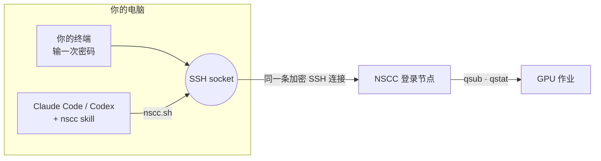

<div align="center">

# nscc-agent

**让 Claude Code 或 Codex 在新加坡 NSCC 超算上替你跑实验、盯实验。**

[](#安装)
[](#安装)
[](#平台)
[](LICENSE)

[English](README.md) · 简体中文

</div>

## 为什么需要它

NSCC 上装不了、也跑不了 Claude Code 或 Codex；NSCC 又只能用密码登录，所以你电脑上的 agent 也登不上去。结果实验没人盯：作业跑十分钟就挂了，第二天早上你才发现。

**nscc-agent** 解决的就是这个问题。你在自己的终端里**登录一次**，你电脑上的 agent 就复用这条 SSH 连接：上传代码、配环境、提交 PBS 作业，**一直盯到作业结束，读日志、修错误、重新提交**。密码始终只在你自己的终端里输入。

一次对话大概是这样：

```text
你     ▸ 在 NSCC 上用 1 张卡微调 configs/lora.yaml，帮我盯着。
Agent  ▸ 已上传代码（412 MB，排除了 .venv）→ 作业 25936201 提交到 g1，3 分钟后开始运行。
       ▸ 40 分钟：loss 1.92 → 1.31，显存 18 GB，预计还要 2 小时 10 分钟。
       ▸ 作业失败：评估时 CUDA out of memory。评估 batch 减半，从第 1200 步续跑 → 25936288。
       ▸ 完成。退出码 0，最佳 val loss 1.07。结果已拷回 runs/lora-0423/。
```

## 安装

<details open>
<summary><b>Claude Code</b>（插件）</summary>

```text
/plugin marketplace add LBWSquare666/nscc-agent
/plugin install nscc-agent@nscc-agent
```
</details>

<details>
<summary><b>Codex</b>，或不用插件的 Claude Code</summary>

```bash
curl -fsSL https://raw.githubusercontent.com/LBWSquare666/nscc-agent/main/install.sh | bash
```

会把 skill 拷到 `~/.claude/skills/nscc` 和 `~/.agents/skills/nscc`。只装一个就用 `bash -s claude` 或 `bash -s codex`。
</details>

## 快速开始

1. **写下你的账号信息**（不是密码，每台电脑写一次）：

   ```bash
   mkdir -p ~/.config/nscc && cat > ~/.config/nscc/config <<'EOF'
   NSCC_USER=<你的 NSCC 用户名>
   NSCC_HOST=aspire2antu.nscc.sg
   NSCC_PROJECT=<你的 PBS 项目号>
   EOF
   ```

2. **让 agent 连接。** 说"连上 NSCC"（Claude Code 里也可以用 `/nscc-agent:nscc`，Codex 里用 `$nscc`）。它会给你一条 `ssh` 命令，**你在自己的终端里运行**并输入密码。连接会一直保持，直到你关掉它或电脑断网。

3. **把实验交给它。**

   - "把 `./data` 传到我的 scratch，给这个仓库配一个 uv 环境。"
   - "用 1 张卡跑 4 小时 `train.py`，跑完告诉我。"
   - "作业 25936169 挂了，查原因并修好。"
   - "NSCC 上现在在跑什么？每个作业日志给我看最后几行。"

## 原理



skill 教 agent NSCC 的工作流程和规则，具体操作由一个小脚本 [`nscc.sh`](plugins/nscc-agent/skills/nscc/scripts/nscc.sh) 完成：

| | |
|---|---|
| `check` · `login` | 连接还在吗？不在就给出登录命令让你运行 |
| `run` | 在登录节点上运行一条命令或一段 heredoc 脚本 |
| `put` · `get` | 双向 rsync，断点续传 |
| `submit` | 上传 PBS 脚本，带上你的项目号 `qsub` |
| `jobs` · `status` · `tail` | 最近的作业、单个作业的状态和退出码、日志末尾 |
| `wait` | 在后台等到作业结束；退出码区分成功、失败、断线 |

电脑休眠了，作业照样在 NSCC 上跑。重新登录后，agent 会从作业记录接着盯。

## 安全

- agent 看不到、不代输、不保存你的密码。不用 `sshpass`、`expect`，也不用密码文件。
- 只用你自己开的那条连接；socket 放在 `~/.ssh/cm/`，只有你能读。随时可以让 agent 关掉它（`nscc.sh close`）。
- 作业需要的 API key 由**你自己**运行的一条命令写到 NSCC 上（`read -s`，不回显），不会贴进对话。
- 和任何 SSH 会话一样：能在你电脑上以你身份执行命令的人，也能用这条已打开的连接。

## 平台

| | |
|---|---|
| macOS、Linux | ✅ |
| Windows | ✅ 在 **WSL2** 里用（agent 也跑在 WSL 里）。Windows 自带的 OpenSSH 不支持连接复用 |
| NSCC 系统 | 已在 **ASPIRE 2A**（NTU 登录节点，2026 年 10 月）实测。其他登录节点改 `NSCC_HOST` |

## 值得知道的 NSCC 规则

- 提交到 `-q normal`，PBS 按卡数分队列（1 卡 → g1，2–3 卡 → g2，4 卡 → g3）。
- GPU 作业 walltime 必须**超过 2 小时**（短作业写 `02:10:00`），最长 24 小时。
- **每个队列每人同时只能跑一个作业**，同一账号下所有项目共用这个限制。
- 1 卡作业通常几分钟就能开始；2–3 卡可能要排几个小时。
- 在 `/scratch` 里工作（空间大，会定期清理），不要放 home（约 50 GB）。
- 驱动 570 / CUDA 12.8：cu13x 的包（比如新版 vLLM）要放进 Apptainer 容器，并用 `/usr/local/cuda/compat`。

更多：[PBS](plugins/nscc-agent/skills/nscc/references/pbs.md) · [环境](plugins/nscc-agent/skills/nscc/references/environment.md) · [排错](plugins/nscc-agent/skills/nscc/references/troubleshooting.md)

## 常见问题

**能用 SSH key 吗？** ASPIRE 2A 登录节点目前只接受密码，所以才需要复用连接。

**关掉对话后 agent 还会盯吗？** 不会。agent 跑在你的电脑上，长实验期间要让会话和电脑都开着。作业本身不受影响。

**总是让我重新登录？** 电脑休眠或换了网络，连接就断了。再运行一次登录命令即可。

**VS Code Remote-SSH 还能用吗？** 能，两者互不影响；VS Code 自己开连接、自己问密码。

---

<sub>非官方项目，与 NSCC Singapore 无关联、未获其背书。MIT © LBWSquare</sub>
