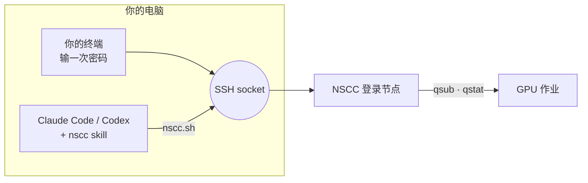

<div align="center">

# nscc-agent

**让 Claude Code 或 Codex 在新加坡 NSCC 超算上替你跑实验、盯实验。**

[](#安装)
[](#安装)
[](#安装)
[](LICENSE)

作者：LBWSquare

[English](README.md) · 简体中文

</div>

## 能做什么

你在自己的终端里登录一次，agent 就能替你：

- 上传代码、配环境
- 提交 PBS 作业
- 盯到作业结束，读日志
- 失败了查原因、修好、重新提交

密码只在你自己的终端里输入，agent 看不到。

## 解决什么问题

- **实验没人盯。** 作业跑十分钟就挂了，第二天早上才发现。
- **agent 登不上 NSCC。** NSCC 只能用密码登录，agent 没法自己登录。
- **Claude Code 装不上 NSCC。** NSCC 拦截了 `claude.ai` 和 npm，按官方文档安装会失败。

## 两种用法

| | **A. agent 在你的电脑上**（默认） | **B. agent 在 NSCC 上** |
|---|---|---|
| 怎么用 | agent 复用你开的 SSH 连接 | Claude Code 装在登录节点上，用手机远程操作 |
| 优点 | · Claude Code、Codex 都能用<br>· 代码留在本地<br>· NSCC 上不用装东西 | · 电脑可以关机<br>· 手机随时查看<br>· 不会因电脑休眠掉线 |
| 缺点 | · 电脑要一直开机联网<br>· 休眠后要重新输密码<br>· Windows 要用 WSL2 | · 只支持 Claude Code<br>· 需要 Pro/Max/Team/Enterprise 账号<br>· 登录节点重启后要手动重启 |
| 上手 | [快速开始](#快速开始) | [`on-nscc.md`](plugins/nscc-agent/skills/nscc/references/on-nscc.md) |

白天在电脑前用 A，过夜的长实验用 B，两者可以同时用。

## 安装

<details open>
<summary><b>Claude Code</b>（插件）</summary>

```text
/plugin marketplace add LBWSquare666/nscc-agent
/plugin install nscc-agent@nscc-agent
```
</details>

<details>
<summary><b>Codex</b>，或不用插件的 Claude Code</summary>

```bash
curl -fsSL https://raw.githubusercontent.com/LBWSquare666/nscc-agent/main/install.sh | bash
```
</details>

支持 macOS、Linux、Windows（WSL2）。

## 快速开始

1. **写下账号信息**（不是密码，每台电脑写一次）：

   ```bash
   mkdir -p ~/.config/nscc && cat > ~/.config/nscc/config <<'EOF'
   NSCC_USER=<你的 NSCC 用户名>
   NSCC_HOST=aspire2antu.nscc.sg
   NSCC_PROJECT=<你的 PBS 项目号>
   EOF
   ```

2. **让 agent 连接。** 说"连上 NSCC"，它会给你一条 `ssh` 命令。在你自己的终端里运行，输入密码。

3. **把实验交给它。** 例如：
   - "用 1 张卡跑 4 小时 `train.py`，跑完告诉我。"
   - "作业 25936169 挂了，查原因并修好。"

## 原理



skill 教 agent NSCC 的流程和规则，具体操作由 [`nscc.sh`](plugins/nscc-agent/skills/nscc/scripts/nscc.sh) 完成：

| 命令 | 作用 |
|---|---|
| `check` | 检查连接，不在就给出登录命令 |
| `run` | 在登录节点上执行命令 |
| `put` · `get` | 上传、下载（断点续传） |
| `submit` | 提交 PBS 作业 |
| `jobs` · `status` · `tail` | 查作业、看状态、看日志 |
| `wait` | 在后台等作业结束 |

NSCC 的使用规则和排错见：[PBS](plugins/nscc-agent/skills/nscc/references/pbs.md) · [环境](plugins/nscc-agent/skills/nscc/references/environment.md) · [排错](plugins/nscc-agent/skills/nscc/references/troubleshooting.md)

## 安全

- agent 看不到、不代输、不保存你的密码。
- 只使用你自己开的连接，随时可以关掉（`nscc.sh close`）。
- 作业要用的 API key 由你自己在终端里写到 NSCC 上，不经过对话。

## 常见问题

**关掉对话后还会盯吗？** 用法 A 不会，要让电脑和会话一直开着；用法 B 会。作业本身都不受影响。

**总是让我重新登录？** 电脑休眠或换网络会断开连接，再运行一次登录命令即可。想让电脑关机也能盯，用用法 B。

---

<sub>非官方项目，与 NSCC Singapore 无关联、未获其背书。MIT © LBWSquare</sub>
