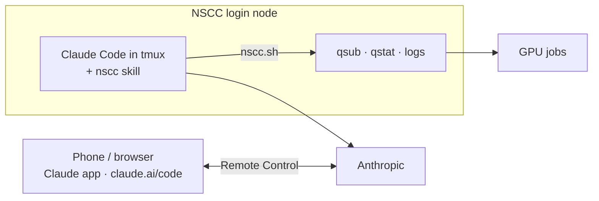

# Running Claude Code on NSCC itself

Install Claude Code on the NSCC login node, keep it running in `tmux`, and steer it from your phone or any browser with [Remote Control](https://code.claude.com/docs/en/remote-control). Your own computer can be off.



You need a claude.ai Pro, Max, Team or Enterprise plan. Pros and cons versus running the agent on your computer: see the [README](../../../../../README.md#two-ways-to-run-it).

## 1. Install

The official `curl -fsSL https://claude.ai/install.sh | bash` fails on NSCC because `claude.ai` is blocked. Run the same installer from `downloads.claude.ai` instead, in a terminal on NSCC:

```bash
curl -fsSL https://downloads.claude.ai/claude-code-releases/bootstrap.sh | bash
grep -q 'HOME/.local/bin' ~/.bashrc || echo 'export PATH="$HOME/.local/bin:$PATH"' >> ~/.bashrc
export PATH="$HOME/.local/bin:$PATH"
claude --version
```

Don't use npm; it is blocked too.

## 2. Add the skill and project rules

Install the skill with the `install.sh` one-liner from the README. Then put a `CLAUDE.md` in your project directory:

```markdown
- You are running on an NSCC login node. Light work only: edit files, read logs, qstat, qsub.
- Training, rendering and other heavy work always go to a compute node with qsub.
```

## 3. Start it inside tmux

```bash
hostname                     # note which login node you are on
tmux new -s cc               # later: tmux attach -t cc
cd /scratch/users/<org>/<user>/<project>
claude --remote-control      # first run: trust the folder, then /login
```

- **Always use `tmux`.** Without it, closing VS Code or SSH stops Claude.
- **There are two login nodes.** If `tmux attach` says `no sessions`, you landed on the other one: `ssh <noted hostname>`, then attach.
- **First login:** `/login` prints a link. Open it on your computer or phone, approve, and paste the code back.
- Detach with `Ctrl-b d`. You can now close VS Code and turn off your computer.

## 4. Use it from your phone

Open the session from the **Code** tab of the Claude app, or at [claude.ai/code](https://claude.ai/code). Online sessions have a green dot. `/remote-control` inside the session shows its link and a QR code.

- Permission prompts and questions show up on your phone; Claude waits until you answer.
- Use `claude --remote-control`, not `claude remote-control`: the latter exits after about 10 minutes without network.
- If it reports `could not reach the Remote Control server`, attach to `tmux` and run `/remote-control`.

## 5. When it stops

A login-node reboot or maintenance ends the `tmux` session. Jobs keep running. Log in again and continue where you left off:

```bash
tmux new -s cc
cd <project> && claude --continue --remote-control
```

## Security

- Your Claude login is stored in `~/.claude/` on a shared machine. Keep it private: `chmod -R go-rwx ~/.claude`. Run `/logout` when you stop using this setup.
- In your claude.ai settings, turn on **Require trusted devices** so only your own devices can control the session.
